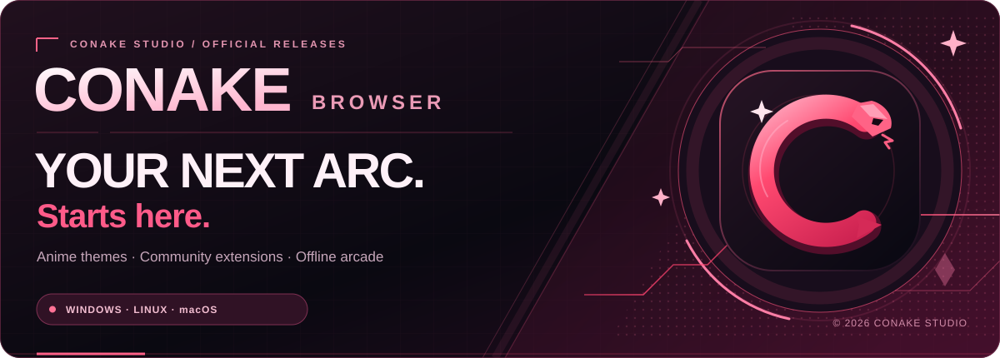
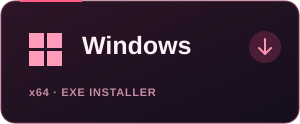
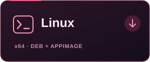
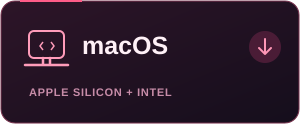
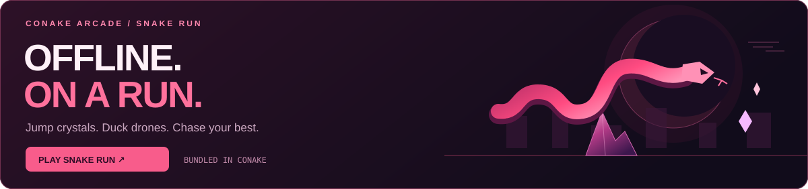
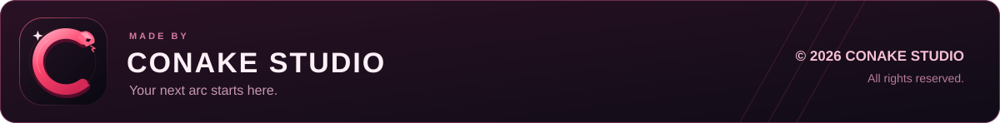

<p align="center">
  <a href="https://menacing-aura.github.io/Conake-Browser/">
    
  </a>
</p>

<p align="center">
  <strong>CONAKE BROWSER · ANIME ECLIPSE · v0.1.23 DESKTOP PREVIEW</strong><br>
  Anime-styled desktop browser with custom themes, community extensions, encrypted local profiles, and built-in Snake Run. Windows · Linux · macOS.
</p>

<p align="center">
  <a href="https://menacing-aura.github.io/Conake-Browser/"><strong>Download center ↗</strong></a>
  &nbsp;·&nbsp;
  <a href="https://conake-studios.web-one1aura.workers.dev/">Conake Studio</a>
  &nbsp;·&nbsp;
  <a href="https://conake-extensions.web-one1aura.workers.dev/">Extension Store</a>
  &nbsp;·&nbsp;
  <a href="https://conake-domains.web-one1aura.workers.dev/">Conake Names</a>
  &nbsp;·&nbsp;
  <a href="https://discord.gg/BMcST6NaZS">Discord</a>
</p>

## Start your first arc

**[Open the setup guide ↗](https://conake-domains.web-one1aura.workers.dev/setup)** for the right installer, first launch, profiles, wallpapers, tabs, fullscreen and Snake Run. On desktop, open **Quick setup** from a new tab or **Navigate → Setup Guide**. The desktop guide works offline and can apply your theme and search engine.

**[Sign in with Conake ↗](https://conake-domains.web-one1aura.workers.dev/account)** to manage your .conake names. Existing Names credentials still work. Confirm your password when creating or recovering an account, save your private recovery code, choose session-only or seven-day sign-in, review active sign-ins, change the online password, and sign out other devices.

Your online Names account, encrypted desktop profile and Extension Store account are separate. The desktop unlock screen now has clearer labels, password and confirmation visibility, and Caps Lock feedback. Google sign-in is not configured.

## Choose your platform

**Real installers. Download, open, and start your next arc.** No source checkout or Node.js needed.

<table>
  <tr>
    <td width="33%" align="center" valign="top">
      <a href="https://github.com/menacing-aura/Conake-Browser/releases/download/v0.1.23/ConakeBrowser-0.1.23-win-x64.exe"></a><br>
      <a href="https://github.com/menacing-aura/Conake-Browser/releases/download/v0.1.23/ConakeBrowser-0.1.23-win-x64.exe"><strong>Windows · .exe ↓</strong></a>
    </td>
    <td width="33%" align="center" valign="top">
      <a href="https://github.com/menacing-aura/Conake-Browser/releases/download/v0.1.23/conake-browser_0.1.23_amd64.deb"></a><br>
      <a href="https://github.com/menacing-aura/Conake-Browser/releases/download/v0.1.23/conake-browser_0.1.23_amd64.deb"><strong>Ubuntu / Mint / Debian · .deb v0.1.23 preview ↓</strong></a><br>
      <a href="https://github.com/menacing-aura/Conake-Browser/releases/download/v0.1.23/ConakeBrowser-0.1.23-linux-x86_64.AppImage">Other Linux · AppImage v0.1.23 preview ↓</a>
    </td>
    <td width="33%" align="center" valign="top">
      <a href="https://github.com/menacing-aura/Conake-Browser/releases/download/v0.1.23/ConakeBrowser-0.1.23-mac-arm64.dmg"></a><br>
      <a href="https://github.com/menacing-aura/Conake-Browser/releases/download/v0.1.23/ConakeBrowser-0.1.23-mac-arm64.dmg"><strong>Apple Silicon · .dmg ↓</strong></a><br>
      <a href="https://github.com/menacing-aura/Conake-Browser/releases/download/v0.1.23/ConakeBrowser-0.1.23-mac-x64.dmg">Intel Mac · .dmg ↓</a>
    </td>
  </tr>
</table>

**New desktop v0.1.23 preview:** Windows, Linux and macOS installers above include editable New Tab shortcuts, favorite tiles, an improved bookmark manager and an F1 keyboard guide. Earlier tab performance, approximate RAM on hover, website JavaScript controls, Inspect and reviewed content-script imports are included. The Chromebook APK remains Preview 06.

<p align="center">
  <a href="https://github.com/menacing-aura/Conake-Browser/releases/tag/v0.1.23">What's new in desktop v0.1.23</a>
  &nbsp;·&nbsp;
  <a href="https://github.com/menacing-aura/Conake-Browser/releases/download/v0.1.23/SHA256SUMS.txt">SHA-256 checksums</a>
  &nbsp;·&nbsp;
  <a href="https://github.com/menacing-aura/Conake-Browser/releases">All releases</a>
</p>

### Chromebook · Android preview

[Download Chromebook APK · Preview 06 ↓](https://github.com/menacing-aura/Conake-Browser/releases/download/v0.1.21-chromebook.6/ConakeBrowser-Chromebook-0.1.21-preview6.apk) · [Installation instructions](https://github.com/menacing-aura/Conake-Browser/releases/tag/v0.1.21-chromebook.6) · [APK checksum](https://github.com/menacing-aura/Conake-Browser/releases/download/v0.1.21-chromebook.6/SHA256SUMS.txt)

Preview 06 adds Chrome Web Store browsing from the browser menu; Android extension installation is not supported. It retains the upper address-bar fixes for physical Enter and numpad Enter, supports more on-screen keyboard actions, and adds a visible Go button. It also includes Quick setup, official Conake Account links, .conake name navigation, the anime dashboard, saved bookmarks and history, editable quick links, native tab controls, find-in-page, desktop-site mode, copy/share, downloads and more settings. It is a separate Android WebView edition for supported Chromebooks and requires Android app support, ADB sideloading, and an internet connection. Desktop accounts and extensions are not included. Preview 01 was reported running on a hatch Chromebook; this update is checked in an Android tablet emulator.

**Phone warning:** opening this APK on a phone can trigger a 48-hour IP ban, including for other devices sharing the same public IP. Device identification can be inaccurate or bypassed.

The verification service sees the public IP and device category to apply this restriction; it does not receive browsing addresses. The Chromebook preview stores game scores locally and requires an internet check to open the app. Saved bookmarks, history and quick links are encrypted with an Android Keystore key; anyone using the unlocked app can view them. Keep app data when updating with `adb install -r`.

> **Installing Conake?** Pick an installer above. GitHub's **Code → Download ZIP** and **Source code** archives contain this download website's files.

## Your favorites. One click away.

- **Website shortcuts:** open New Tab → **+ Add shortcut**. Save up to 16 links; use a tile's **⋯** to rename, change its address or remove it.
- **Favorite pages:** click the address-bar star or press **Ctrl/Command+D**. Your eight newest bookmarks appear on New Tab.
- **Manage the collection:** choose **View all bookmarks**, **Ctrl/Command+B** or **Ctrl/Command+Shift+O** to add, edit, search and remove favorites.
- **Learn the keys:** press **F1** or open **View → Keyboard Shortcuts** for the bundled guide.

Favorites and shortcuts stay in your encrypted local profile and return after sign-in. Existing bookmarks are preserved.

## A name for your next arc.

**[Register a free .conake name ↗](https://conake-domains.web-one1aura.workers.dev/)** for an existing public HTTPS website. Create a separate registry account, claim up to five names, update their destinations, or pause them while keeping ownership. Save your private recovery code.

Desktop **v0.1.23** and **Chromebook Preview 06** resolve addresses such as `studio.conake`, `arcade.conake`, and `register.conake` from the address bar. The real HTTPS destination stays visible. This is a central Conake-only alias registry, separate from public DNS, without hosting, Tor routing, or anonymity. The registry receives the name lookup and public IP; other browsing addresses are not sent by the resolver.

## Keep your place.

Website pop-ups are blocked by default. Open **Site Shield** beside the address bar to review blocked addresses and set pop-up or redirect rules for the current site. The redirect guard is enabled by default for enma.lol and its subdomains; other sites can opt in. It also blocks ordinary links leaving a guarded site.

Back from a reviewed pop-up uses its own history first, then returns to its source tab when there is no history. Site rules stay encrypted in your local account. The blocked list stays in memory. Some in-page ads or embedded-frame content may remain.

## Your next scene.

Four original, offline wallpapers: Crimson Eclipse, Sakura Shrine, Neon Rain, and Lunar Tide. Open **Settings → New tab & wallpapers** for the gallery, live preview, darkness, blur, shuffle, and clock / quick-link / Snake Run-card switches. Appearance includes five color themes. Search & fullscreen settings select Google, DuckDuckGo, or Bing and control whether browser bars stay visible.

## Your window. Your view.

The Anime Eclipse title bar now has fullscreen, minimize, maximize/restore, and close controls that follow your theme. Use **F11** (**Control+Command+F** on Mac) or the fullscreen button; **Escape** exits browser fullscreen. Pages fill the display by default; **Ctrl/Command+L** restores the address bar, and right-clicking the page offers **Exit Browser Fullscreen**. You can retain browser bars in Settings.

Open **View** for Compact / Comfortable / Wide window sizes and page zoom presets from **25% to 300%**. Drag the title strip to move the window and its edges to resize it. Your tabs and typed drafts stay in place.

## Your tabs. Your rules.

**In the desktop v0.1.23 preview**, switching tabs keeps existing page surfaces and avoids repeated background updates. Hover or focus a tab to see approximate renderer RAM. A shared renderer can include several tabs; GPU memory and separate subframes are excluded.

Open **Settings → Websites & developer tools** to allow or disable website JavaScript. Saving a change reloads open websites; Conake's own pages remain interactive. Some sites need JavaScript for login or video. Open website DevTools with **right-click → Inspect**, **View → Inspect Page**, **F12** or **Ctrl/Command+Shift+I**.

Drag tabs to reorder them. Open **Tab Studio** beside the + button to rename a tab, pick a preset or custom accent color, pin it, and choose compact, comfortable, or roomy tabs.

Right-click for **duplicate, mute/unmute, move, close other unpinned tabs**, and **close unpinned tabs to the right**. Reopen a closed tab with **Ctrl/Command+Shift+T**; move the selected tab with **Ctrl/Command+Shift+PageUp/PageDown**.

Up to **40 pinned tabs** keep their order, addresses, names, and colors in your encrypted account and reopen after sign-in. Other tabs and their styles reset when you lock or exit; the closed-tab list resets too. Website sessions still end on lock. Dragging stays within the current window.

## Enter the Conake universe

| Make it yours | Build your loadout | Keep your space |
| :--- | :--- | :--- |
| Crimson Eclipse, Violet Pulse, and Midnight themes. Toggle artwork and reduce motion in **Settings → Appearance**. | Browse community extensions or publish your own JavaScript and CSS content scripts in the **Conake Extension Store**. | Sign in to a password-encrypted local profile for bookmarks, history, settings, API keys, and your Snake Run best. |

### No internet? Run anyway.

<a href="https://conake-studios.web-one1aura.workers.dev/snake-run/">
  
</a>

**Snake Run is bundled into Conake v0.1.23.** Open it from a new tab, **Navigate → Snake Run**, a connection-error page, or `conake://snake-run`. No extra game download needed.

| Jump | Duck | Pause | Restart |
| :--- | :--- | :--- | :--- |
| Space / ↑ / W | Hold ↓ / S | P / Escape | R |

Touch controls and optional sound are included. Your best score stays in your encrypted local profile.

**[Play Snake Run on the web ↗](https://conake-studios.web-one1aura.workers.dev/snake-run/)** · Visit once online to cache the web game for offline play. Web scores stay in that browser on that device.

## Get started

1. Download the installer for your computer and open it.
2. Create a **local account** with a password of at least **12 characters**.
3. Pick a theme, explore the web, and try **Snake Run** from your new-tab page.

<details>
<summary><strong>Accounts, sign-in, and local privacy</strong></summary>

Sign in to unlock your encrypted bookmarks, history, settings, download list, API keys, extensions, and Snake Run best score. Click **Lock** to sign out and close your tabs.

Accounts stay on this computer. There is **no cloud sync or password recovery**, so keep your password safe. Website sessions end on sign-out or restart. Pinned addresses reopen in a fresh session after you sign in. Extension mode temporarily stores session data on disk and clears it during a normal lock or exit; a crash can leave temporary files behind. Downloaded files and exported backups remain ordinary files outside the encrypted profile.

</details>

<details>
<summary><strong>Extensions and creator tools</strong></summary>

Visit the **[Extension Store](https://conake-extensions.web-one1aura.workers.dev/)** to browse extensions, or create a separate store account to publish your own JavaScript and CSS content scripts.

Inside Conake, open **Extensions**, review the source and website access, and choose whether to install. Enable **extension mode**, then lock and sign in again to activate it.

The current format supports content scripts on HTTP/HTTPS websites. It does not install arbitrary Chrome Web Store or CRX packages. Creator submissions are not automatically reviewed.

The **desktop v0.1.23 preview** includes Chrome Web Store browsing and reviewed imports of unpacked Manifest V3 extensions containing one JavaScript file and one CSS file. Review their code and website access before importing; background services and other Chrome APIs are not supported.

</details>

<details>
<summary><strong>Copy, paste, and editing menus</strong></summary>

Right-click or use a two-finger trackpad click for text, link, and image options. Click **Edit ▾** beside Lock to open editing options with a normal left click.

Use **Ctrl+C**, **Ctrl+X**, **Ctrl+V**, and **Ctrl+A** for copy, cut, paste, and select all. Use **Command** on Mac.

</details>

<details>
<summary><strong>Installer checksums</strong></summary>

Download **[v0.1.23 SHA-256 checksums for all desktop installers](https://github.com/menacing-aura/Conake-Browser/releases/download/v0.1.23/SHA256SUMS.txt)** into the same folder as your installer. Compare your file's SHA-256 hash with its entry:

**Windows · PowerShell**

```powershell
Get-FileHash .\ConakeBrowser-0.1.23-win-x64.exe -Algorithm SHA256
```

**Linux**

```sh
sha256sum conake-browser_0.1.23_amd64.deb
```

**macOS · Apple Silicon**

```sh
shasum -a 256 ConakeBrowser-0.1.23-mac-arm64.dmg
```

Use the filename you downloaded if you chose AppImage or an Intel Mac installer.

</details>

## Find your people

| Community & support | Support Conake | Work & collaborations |
| :--- | :--- | :--- |
| **[Join the Discord ↗](https://discord.gg/BMcST6NaZS)**<br>Get help, share feedback, and meet the community. | **[Donate on Cash App ↗](https://cash.app/$one1aura)**<br>Help support Conake's next arc. | **[godscripters@gmail.com](mailto:godscripters@gmail.com)**<br>Ideas, partnerships, and work enquiries. |

<details>
<summary><strong>About this repository · for maintainers</strong></summary>

This public repository contains Conake's download website, release installers, and distribution tooling. Application source is maintained in a separate private development repository. **Conake's original materials are proprietary and are not open-source.** Distributed installers can still be inspected. Third-party components remain subject to their own licenses.

The import workflow can transfer installers only from publicly accessible releases. With the development repository private, a maintainer uploads the five installers and `SHA256SUMS.txt` here, verifies them, and updates the version links in `README.md`, `index.html`, and `RELEASE_NOTES.md`. The platform artwork is version-independent.

Only download-page assets belong in this repository. Application source archives are maintained separately.

</details>

<p align="center">
  <br>
  <br>
  <sub>© 2026 Conake Studio. All rights reserved. · <a href="LICENSE">Proprietary license</a> · <a href="COPYRIGHT.txt">Copyright notice</a></sub>
</p>


