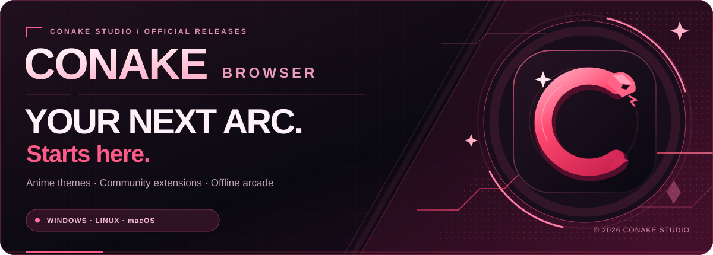
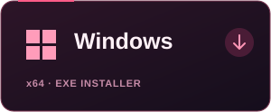
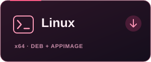
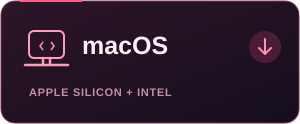
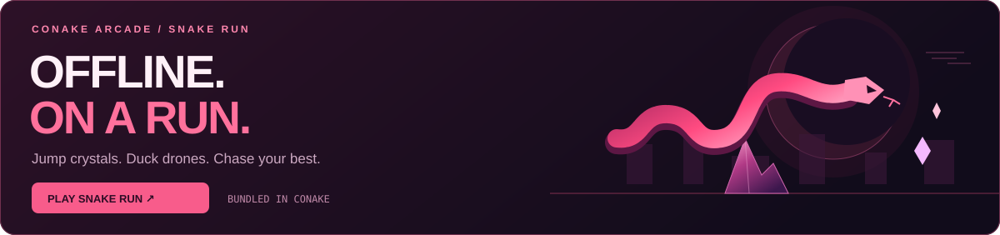
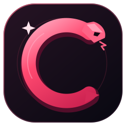

<p align="center">
  <a href="https://menacing-aura.github.io/ConakeBrowser-Downloads/">
    
  </a>
</p>

<p align="center">
  <strong>ANIME ECLIPSE · v0.1.14</strong><br>
  Your browser. Your aesthetic. A little arcade chaos.
</p>

<p align="center">
  <a href="https://menacing-aura.github.io/ConakeBrowser-Downloads/"><strong>Download center ↗</strong></a>
  &nbsp;·&nbsp;
  <a href="https://conake-studios.web-one1aura.workers.dev/">Conake Studios</a>
  &nbsp;·&nbsp;
  <a href="https://conake-extensions.web-one1aura.workers.dev/">Extension Store</a>
  &nbsp;·&nbsp;
  <a href="https://discord.gg/BMcST6NaZS">Discord</a>
</p>

## Choose your platform

**Real installers. Download, open, and start your next arc.** No source checkout or Node.js needed.

<table>
  <tr>
    <td width="33%" align="center" valign="top">
      <a href="https://github.com/menacing-aura/ConakeBrowser-Downloads/releases/download/v0.1.14/ConakeBrowser-0.1.14-win-x64.exe"></a><br>
      <a href="https://github.com/menacing-aura/ConakeBrowser-Downloads/releases/download/v0.1.14/ConakeBrowser-0.1.14-win-x64.exe"><strong>Windows · .exe ↓</strong></a>
    </td>
    <td width="33%" align="center" valign="top">
      <a href="https://github.com/menacing-aura/ConakeBrowser-Downloads/releases/download/v0.1.14/conake-browser_0.1.14_amd64.deb"></a><br>
      <a href="https://github.com/menacing-aura/ConakeBrowser-Downloads/releases/download/v0.1.14/conake-browser_0.1.14_amd64.deb"><strong>Ubuntu / Mint / Debian · .deb ↓</strong></a><br>
      <a href="https://github.com/menacing-aura/ConakeBrowser-Downloads/releases/download/v0.1.14/ConakeBrowser-0.1.14-linux-x86_64.AppImage">Other Linux · AppImage ↓</a>
    </td>
    <td width="33%" align="center" valign="top">
      <a href="https://github.com/menacing-aura/ConakeBrowser-Downloads/releases/download/v0.1.14/ConakeBrowser-0.1.14-mac-arm64.dmg"></a><br>
      <a href="https://github.com/menacing-aura/ConakeBrowser-Downloads/releases/download/v0.1.14/ConakeBrowser-0.1.14-mac-arm64.dmg"><strong>Apple Silicon · .dmg ↓</strong></a><br>
      <a href="https://github.com/menacing-aura/ConakeBrowser-Downloads/releases/download/v0.1.14/ConakeBrowser-0.1.14-mac-x64.dmg">Intel Mac · .dmg ↓</a>
    </td>
  </tr>
</table>

<p align="center">
  <a href="https://github.com/menacing-aura/ConakeBrowser-Downloads/releases/tag/v0.1.14">What's new in v0.1.14</a>
  &nbsp;·&nbsp;
  <a href="https://github.com/menacing-aura/ConakeBrowser-Downloads/releases/download/v0.1.14/SHA256SUMS.txt">SHA-256 checksums</a>
  &nbsp;·&nbsp;
  <a href="https://github.com/menacing-aura/ConakeBrowser-Downloads/releases">All releases</a>
</p>

> **Installing Conake?** Pick an installer above. GitHub's **Code → Download ZIP** and **Source code** archives contain this download website's files.

## Enter the Conake universe

| Make it yours | Build your loadout | Keep your space |
| :--- | :--- | :--- |
| Crimson Eclipse, Violet Pulse, and Midnight themes. Toggle artwork and reduce motion in **Settings → Appearance**. | Browse community extensions or publish your own JavaScript and CSS content scripts in the **Conake Extension Store**. | Sign in to a password-encrypted local profile for bookmarks, history, settings, API keys, and your Snake Run best. |

### No internet? Run anyway.

<a href="https://conake-studios.web-one1aura.workers.dev/snake-run/">
  
</a>

**Snake Run is bundled into Conake v0.1.14.** Open it from a new tab, **Navigate → Snake Run**, a connection-error page, or `conake://snake-run`. No extra game download needed.

| Jump | Duck | Pause | Restart |
| :--- | :--- | :--- | :--- |
| Space / ↑ / W | Hold ↓ / S | P / Escape | R |

Touch controls and optional sound are included. Your best score stays in your encrypted local profile.

**[Play Snake Run on the web ↗](https://conake-studios.web-one1aura.workers.dev/snake-run/)** · Visit once online to cache the web game for offline play. Web scores stay in that browser on that device.

## Get started

1. Download the installer for your computer and open it.
2. Create a **local account** with a password of at least **12 characters**.
3. Pick a theme, explore the web, and try **Snake Run** from your new-tab page.

<details>
<summary><strong>Accounts, sign-in, and local privacy</strong></summary>

Sign in to unlock your encrypted bookmarks, history, settings, download list, API keys, extensions, and Snake Run best score. Click **Lock** to sign out and close your tabs.

Accounts stay on this computer. There is **no cloud sync or password recovery**, so keep your password safe. Website sessions end on sign-out or restart. Extension mode temporarily stores session data on disk and clears it during a normal lock or exit; a crash can leave temporary files behind. Downloaded files and exported backups remain ordinary files outside the encrypted profile.

</details>

<details>
<summary><strong>Extensions and creator tools</strong></summary>

Visit the **[Extension Store](https://conake-extensions.web-one1aura.workers.dev/)** to browse extensions, or create a separate store account to publish your own JavaScript and CSS content scripts.

Inside Conake, open **Extensions**, review the source and website access, and choose whether to install. Enable **extension mode**, then lock and sign in again to activate it.

The current format supports content scripts on HTTP/HTTPS websites. It does not install arbitrary Chrome Web Store or CRX packages. Creator submissions are not automatically reviewed.

</details>

<details>
<summary><strong>Copy, paste, and editing menus</strong></summary>

Right-click or use a two-finger trackpad click for text, link, and image options. Click **Edit ▾** beside Lock to open editing options with a normal left click.

Use **Ctrl+C**, **Ctrl+X**, **Ctrl+V**, and **Ctrl+A** for copy, cut, paste, and select all. Use **Command** on Mac.

</details>

<details>
<summary><strong>Installer checksums</strong></summary>

Download **[SHA256SUMS.txt](https://github.com/menacing-aura/ConakeBrowser-Downloads/releases/download/v0.1.14/SHA256SUMS.txt)** into the same folder as your installer. Compare your file's SHA-256 hash with its entry in the checksum file:

**Windows · PowerShell**

```powershell
Get-FileHash .\ConakeBrowser-0.1.14-win-x64.exe -Algorithm SHA256
```

**Linux**

```sh
sha256sum conake-browser_0.1.14_amd64.deb
```

**macOS · Apple Silicon**

```sh
shasum -a 256 ConakeBrowser-0.1.14-mac-arm64.dmg
```

Use the filename you downloaded if you chose AppImage or an Intel Mac installer.

</details>

## Find your people

| Community & support | Support Conake | Work & collaborations |
| :--- | :--- | :--- |
| **[Join the Discord ↗](https://discord.gg/BMcST6NaZS)**<br>Get help, share feedback, and meet the community. | **[Donate on Cash App ↗](https://cash.app/$one1aura)**<br>Help support Conake's next arc. | **[godscripters@gmail.com](mailto:godscripters@gmail.com)**<br>Ideas, partnerships, and work enquiries. |

<details>
<summary><strong>About this repository · for maintainers</strong></summary>

This public repository contains Conake's download website, release installers, and distribution tooling. Application source is maintained in a separate private development repository. Distributed installers can still be inspected.

The import workflow can transfer installers only from publicly accessible releases. With the development repository private, a maintainer uploads the five installers and `SHA256SUMS.txt` here, verifies them, and updates the version links in `README.md`, `index.html`, and `RELEASE_NOTES.md`. The platform artwork is version-independent.

Only download-page assets belong in this repository. Application source archives are maintained separately.

</details>

<p align="center">
  <br>
  <br>
  <strong>CONAKE STUDIOS</strong><br>
  <sub>Your next arc starts here.</sub>
</p>
